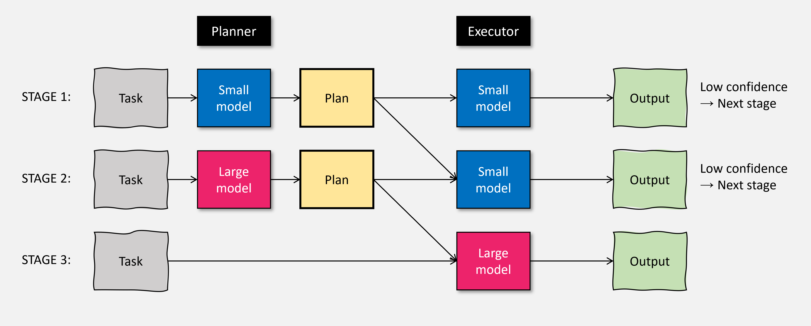

# COPE

This repository contains the codebase for the TMLR paper
**Efficient LLM Collaboration via Planning**
([OpenReview](https://openreview.net/forum?id=RPzbeL0koP), [arXiv](https://arxiv.org/abs/2506.11578)).

**COPE (Collaborative Planning and Execution)** is a test-time collaboration
framework where small and large language models take turns planning and
executing to solve tasks cost-efficiently.

<p align="center">
  
</p>

## Setup

Create and activate a Python environment:

```shell
conda create -n cope python=3.11
conda activate cope
```

Install the package in editable mode:

```shell
pip install -e ".[dev]"
```

Set your OpenAI API key:

```shell
export OPENAI_API_KEY="your-api-key"
```

## Run

Run the default collaborative recipe:

```shell
mkdir -p outputs
python scripts/test_time_compute.py recipes/collaborative.yaml
```

## Acknowledgements

This codebase is adapted from [huggingface/search-and-learn](https://github.com/huggingface/search-and-learn).
